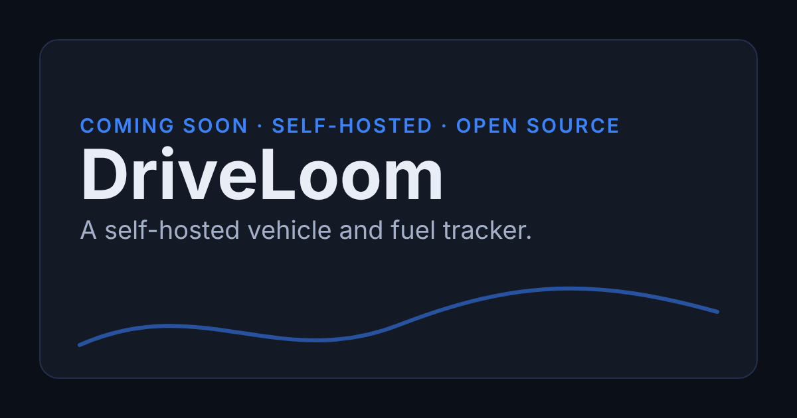

<div align="center">

# DriveLoom

**Every mile, accounted for.**

A self-hosted, open-source fuel tracker for the cars you drive and the people you share them with.

[**Live demo & website**](https://aulteran.github.io/DriveLoom/) · [Self-host in 2 minutes](#self-host-in-2-minutes) · [Report an issue](https://github.com/Aulteran/DriveLoom/issues)



</div>

## Why DriveLoom

- **Economy you can trust.** Full-to-full intervals, with partial top-ups folded into the next full tank. A missed fill-up leaves that interval out instead of skewing your average.
- **Any units in, your units out.** Enter km or miles, litres or gallons; view L/100 km, km/L or mpg. What you typed is kept exactly.
- **Share vehicles.** One owner, editors who log fill-ups, viewers who only read. Compare averages with friends without exposing fill-ups, dates or notes.
- **Costs without guesswork.** One currency per vehicle; no exchange rate is ever assumed.
- **Your data stays yours.** CSV/JSON export and import, full backups with photos, no telemetry, AGPL-3.0.
- **Modern sign-in.** Passwords, authenticator apps and passkeys. Registration is invite-only by default.
- **Installable web app.** Works great on your phone; add it to your home screen.

## Self-host in 2 minutes

You need Docker. You don't need to clone this repo. Save this as `compose.yml`:

```yaml
services:
  db:
    image: postgres:16
    restart: unless-stopped
    environment:
      POSTGRES_USER: driveloom
      POSTGRES_PASSWORD: driveloom
      POSTGRES_DB: driveloom
    volumes:
      - db:/var/lib/postgresql/data
    healthcheck:
      test: pg_isready -U driveloom
      interval: 5s
      retries: 30

  app:
    image: ghcr.io/aulteran/driveloom:latest
    restart: unless-stopped
    depends_on:
      db:
        condition: service_healthy
    environment:
      DATABASE_URL: postgres://driveloom:driveloom@db:5432/driveloom
      DRIVELOOM_PUBLIC_ORIGIN: http://localhost:8080
      DRIVELOOM_SECRET_KEY: replace-me
    ports:
      - 127.0.0.1:8080:8080

volumes:
  db:
```

1. Replace `replace-me` with 32+ random characters (`openssl rand -base64 48`). The app refuses to start until you do.
2. Run `docker compose up -d`, then open <http://localhost:8080> and create your account. The first account becomes the administrator.

The database is never published; its password only has to match in the two places it appears.

**Going public?** Put an HTTPS reverse proxy in front ([Caddy and nginx examples](deploy/proxy/)), set `DRIVELOOM_PUBLIC_ORIGIN` to the exact URL people type (passkeys need HTTPS), and add `DRIVELOOM_SETUP_TOKEN` (16+ characters) so only you can create the first account. To reach it from your LAN instead, drop `127.0.0.1:` from the port.

<details>
<summary><b>Optional settings</b></summary>

Add any of these under `app: environment:`.

| Variable | Purpose |
| --- | --- |
| `DRIVELOOM_SETUP_TOKEN` | Required to create the first (admin) account. 16+ characters. |
| `DRIVELOOM_REGISTRATION` | `closed` (default, invite only) or `open`. |
| `DRIVELOOM_TRUSTED_PROXIES` | Proxy IPs/CIDRs whose `X-Forwarded-For` is trusted, e.g. `172.16.0.0/12`. |
| `DRIVELOOM_PASSWORD_LOGIN` | `0` allows only OIDC and passkeys (needs OIDC configured). |
| `DRIVELOOM_REQUIRE_EMAIL_VERIFICATION` | `1` requires verified email (needs SMTP). |
| `DRIVELOOM_EMAIL_SIGN_IN_CODES` | `1` emails a one-time code after the password (needs SMTP). |
| `DRIVELOOM_SMTP_URL`, `DRIVELOOM_SMTP_FROM` | Outgoing email. |
| `DRIVELOOM_DISABLE_SCHEDULER` | `1` stops the 15-minute background run that queues and sends maintenance reminder emails (Service module). |
| `DRIVELOOM_OIDC_ISSUER`, `_CLIENT_ID`, `_CLIENT_SECRET` | OpenID Connect sign-in; callback `<origin>/v1/auth/oidc/callback`. |

SMTP and OpenID Connect can also be configured from the administrator pages in the app, with no environment variables at all.

**Backups:** `docker compose exec app node scripts/backup.ts create /tmp/dl.dl-backup`, then `docker compose cp app:/tmp/dl.dl-backup .`

**Update:** `docker compose pull && docker compose up -d`

</details>

## Status

Pre-release: usable and tested, but a security review comes before the first tagged release. A native Android app lives in [DriveLoom-Android](https://github.com/Aulteran/DriveLoom-Android).

## Repository

`apps/api` server (Node 22, TypeScript, PostgreSQL 16) · `apps/web` web client · `apps/marketing` project site · `deploy/` proxy examples. Contributions go to `dev`; merging `dev` into `main` publishes the image to `ghcr.io/aulteran/driveloom`.

## License

[AGPL-3.0-only](LICENSE). Bundled third-party assets keep their own terms; see [apps/marketing/ASSET-PROVENANCE.md](apps/marketing/ASSET-PROVENANCE.md).
